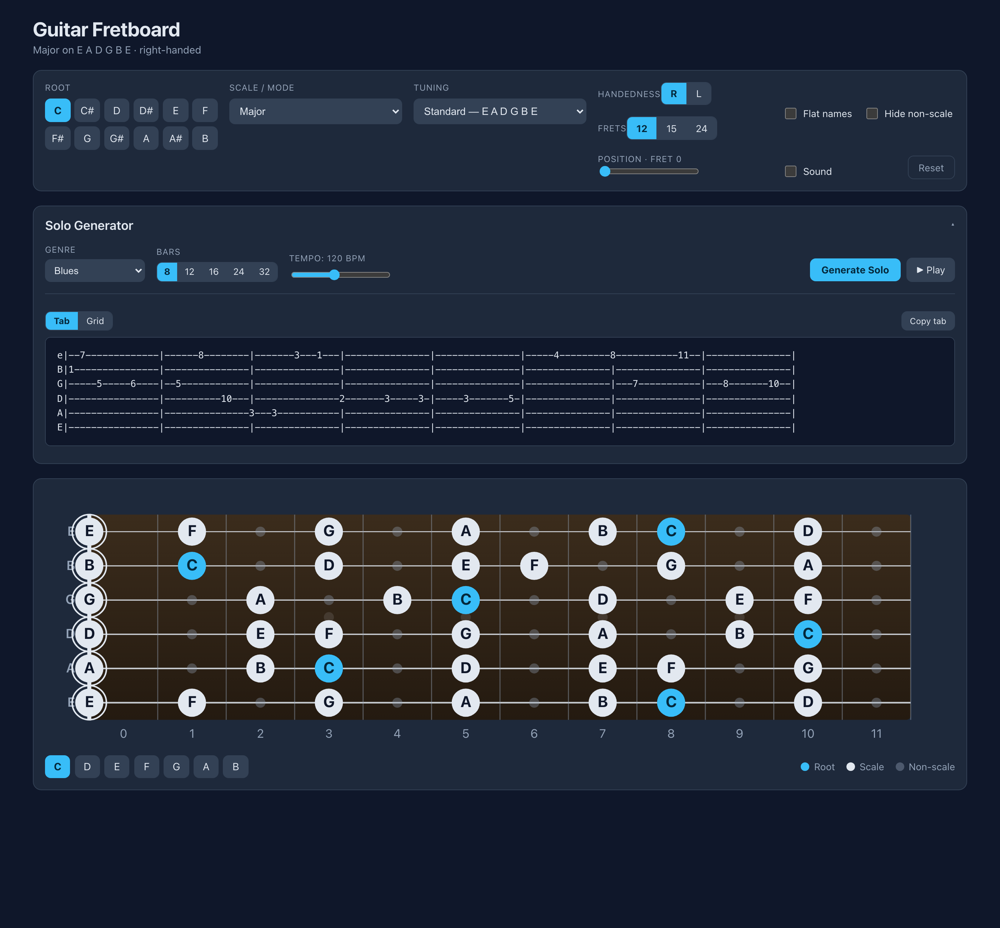

# Guitar Fretboard

A fretboard explorer for guitar, built with React, TypeScript, and Vite. Visualize any scale or mode over any tuning, in either hand, and hear individual notes through a lightweight Web Audio "pluck" synth.



The panel in the middle is the **solo generator**: it writes a playable phrase and renders it as standard guitar tab (`e| B| G| D| A| E|`), with fret numbers placed on the string and beat where they are actually played.

## Features

- **Fretboard view** — render 12, 15, or 24 frets starting from any position, with position markers, open-string labels, and right- or left-handed layout.
- **Scales & modes** — 40+ scales across the major/minor families, modes of major, harmonic minor, and melodic minor, pentatonics, blues, symmetric, and exotic categories.
- **Tunings** — 14 options from Standard and Drop C to Open G, DADGAD, and 7- and 8-string sets.
- **Note coloring** — root, in-scale, and non-scale notes are color-coded; non-scale notes can be hidden entirely.
- **Note names** — sharp or flat spelling throughout.
- **Sound** — optional plucked-string audio for any note, synthesized in-browser with Web Audio (no samples).
- **Solo generator** — writes genre-aware phrases (blues, rock, metal, jazz, country) over the current scale and tuning, rendered as standard ASCII guitar tab or a positioned grid, with copy-to-clipboard and playback.
- **Persistence** — all settings are clamped on change and saved to `localStorage`.

## Getting started

```bash
npm install
npm run dev       # start the dev server with HMR
npm run build     # type-check (tsc -b) and build for production
npm run lint      # oxlint
npm test          # theory/tab unit tests (bundled with rolldown, run in node)
npm run preview   # serve the production build locally
```

## Screenshots

`docs/screenshot.png` is generated, not hand-taken. Start the dev server, then:

```bash
npm run dev &   # serve on :5199
npm run screenshot
```

The script drives headless Chrome over the DevTools Protocol using only Node's
built-in `WebSocket`, so it adds no dependencies. It expands the solo panel and
clicks *Generate Solo* so the tab is visible in the capture. Tune it with
`SHOT_WIDTH`, `SHOT_HEIGHT` and `SHOT_APP_MAX_WIDTH`.

## Project structure

```
src/
  components/     # Fretboard (SVG), ControlPanel, ScaleLegend, SoloGenerator
  hooks/          # useSettings (persisted state), useNotePlayer, useSoloPlayer
  lib/
    theory/       # Pure TypeScript, no React: note spelling, scale library,
                  # tunings, settings validation, fretboard model, solo + tab
    audio.ts      # Web Audio pluck synth
    soloAudio.ts  # Sequenced solo playback
test/             # Unit tests for tuning, fret and tab logic
docs/             # Generated screenshot assets
scripts/          # Test runner, tab demo, screenshot capture
```

The `lib/theory` modules are deliberately framework-agnostic and side-effect free, so the music logic is easy to test and reuse.

## Linting

Oxlint is configured for fast checks. For a production app, consider enabling type-aware rules with `oxlint-tsgolint`:

```json
{
  "$schema": "./node_modules/oxlint/configuration_schema.json",
  "plugins": ["react", "typescript", "oxc"],
  "options": {
    "typeAware": true
  },
  "rules": {
    "react/rules-of-hooks": "error",
    "react/only-export-components": ["warn", { "allowConstantExport": true }]
  }
}
```

See the [Oxlint rules documentation](https://oxc.rs/docs/guide/usage/linter/rules) for the full list of rules and categories.
